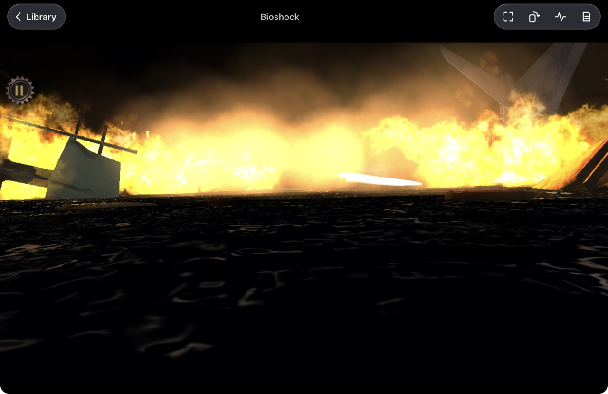

# Retrove

Retrove runs 32-bit iOS games in the browser. You add your own IPA and it stays on your device.

Try it at [retrove.emuready.workers.dev](https://retrove.emuready.workers.dev).

## Status

Early and experimental. BioShock, Cut the Rope, Angry Birds, Doodle Jump, Gyrotate, Zippo and Rayman 2 boot and render in Chrome on macOS. BioShock gets into gameplay, but on an iPhone 13 Pro Max it runs at 18 to 25 FPS with heavy stutter, so it isn't playable yet. Performance is what I'm working on now. Android support is planned.

## How it works

Guest ARM code is translated into WebAssembly on a worker. Code the translator can't handle falls back to a bundled build of the [Unicorn](https://www.unicorn-engine.org) interpreter. UIKit, OpenGL ES, audio, input and the parts of libSystem the games need are reimplemented in TypeScript and JavaScript on top of WebGL and Web Audio.

## Development

Uses Vite+ with pnpm:

- `vp install` installs dependencies
- `vp dev` starts the app on port 8088
- `vp check` runs formatting, lint and type checks
- `vp test` runs the tests
- `vp build` creates the static build

`src/` is the TypeScript implementation. `web/vendor/` contains generated upstream JS/Wasm and their licenses.

To rebuild the guest libc helpers in `src/runtime/ios/libc/`, run `RETROVE_LLVM_BIN=/path/to/llvm/bin vp exec node src/build/compile-guest-libc.ts`.

To rebuild the Unicorn module, activate Emscripten 3.1.69 and run `sh scripts/rebuild-unicorn.sh`.

## License

GPL-2.0-or-later, see `LICENSE`. Retrove includes Unicorn (GPLv2). Third-party licenses are in `web/vendor/`, and source provenance is in `NOTICE.md`.
